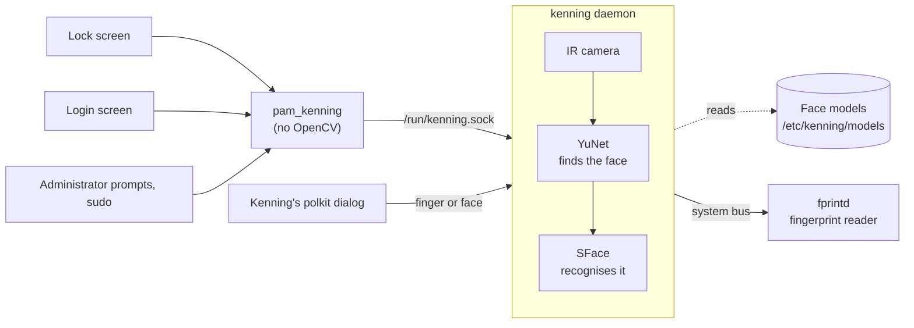

<div align="center">

<picture>
  <source media="(prefers-color-scheme: dark)" srcset="docs/images/banner-dark.svg">
  
</picture>

Sign in, unlock and approve with your face, on the login screen, the lock screen and in System Settings.<br>
<sub>To <i>ken</i> someone is to know or recognise them.</sub>

[](https://github.com/RishonDev/kenning/releases/latest)
[](https://github.com/RishonDev/kenning/actions/workflows/lockscreen.yml)
[](#plasma-versions)
[](LICENSES/GPL-2.0-or-later.txt)

[](https://github.com/RishonDev/kenning/releases/latest)
[](https://github.com/RishonDev/kenning/issues/new/choose)

<br>

<picture>
  <source media="(prefers-color-scheme: dark)" srcset="docs/images/settings-dark.png">
  
</picture>

</div>

## Features

- **Unlock by looking at your screen.** Works on the lock screen, the login screen, administrator prompts and `sudo` in the terminal.
- **Your password always works.** If your face isn't recognised, or you'd rather type, just type your password.
- **Password first after a restart.** Like a phone, face unlock starts working once you've signed in with your password since the computer started, so a laptop stolen while switched off can't be opened with your face alone.
- **Easy setup.** System Settings shows you where to look and when to turn your head, and can read the steps aloud.
- **Best with a face sign-in camera.** Many laptops have an infrared (IR) camera next to the normal one, made for face sign-in. Kenning uses it when it's there, because it works in the dark and is much harder to fool with a photo. An ordinary webcam works too, and Kenning tells you what that means for security.
- **Fits in with Plasma.** On Plasma 6.8 it appears as Plasma's own Face sign-in option, next to fingerprint and password. You can change how the face scan animation looks, or install new designs.
- **Fingerprint as a choice of its own.** With a fingerprint reader, Fingerprint becomes a button next to Password and Face on the lock screen and in administrator prompts, instead of a silent wait before the password. Kenning uses the reader through fprintd, so any reader fprintd supports works.
- **Your face stays on your computer.** Kenning never connects to the network, and the saved face data can only be read by Kenning itself, not by other apps or other users. See [Privacy](#privacy).

## Install

### 1. Check that your computer can use it

You need:

- **KDE Plasma 6.3 or newer.** To check, open **System Settings › About this System** and look at **KDE Plasma Version**.
- **A camera.** An IR camera, the kind laptops have for signing in with your face, works best. An ordinary webcam works too, but it's easier to fool (see [Security and limitations](#security-and-limitations)).
- **One of these:** Ubuntu 26.04 or 26.10 (including Kubuntu), Debian 13, Fedora 44 or Arch Linux. **About this System** shows which one you have, next to **Operating System**.

> [!WARNING]
> With an ordinary webcam, a photo or video of you may be enough to unlock your computer. Use it only if that's an acceptable risk for you, and keep it off for administrator prompts.

> [!WARNING]
> **Debian and Ubuntu are less complete for now.** Face unlock works on the lock screen, for administrator prompts and for `sudo`, but:
> - **Not on the login screen.** Debian and Ubuntu use SDDM, and Kenning's login screen support needs Plasma Login Manager. Sign in with your password after starting the computer.
> - **A simpler lock screen.** Their Plasma is older than 6.8, so face unlock runs before the password box instead of as its own sign-in option, and there's no **Try Face Again** button: if your face isn't recognized, type your password.
> - **Only tested in containers so far,** not yet on real laptops. Please [report](https://github.com/RishonDev/kenning/issues/new/choose) anything that doesn't work.
>
> This improves once they ship Plasma 6.8 and Plasma Login Manager.

### 2. Download and install it

Open **Konsole** (search for it in the application launcher). Copy the lines for your system, paste them with **Ctrl+Shift+V**, and press **Enter**. When asked for your password, type it and press **Enter**. Nothing shows on screen while you type it; that's normal.

The first line installs `wget`, which downloads the package; many systems don't have it yet.

**Ubuntu or Kubuntu 26.04**
```sh
sudo apt install wget
cd ~/Downloads
wget https://github.com/RishonDev/kenning/releases/download/v0.8.1/kenning_0.8.1-1_ubuntu26.04_amd64.deb
sudo apt install ./kenning_0.8.1-1_ubuntu26.04_amd64.deb
```

**Ubuntu or Kubuntu 26.10**
```sh
sudo apt install wget
cd ~/Downloads
wget https://github.com/RishonDev/kenning/releases/download/v0.8.1/kenning_0.8.1-1_ubuntu26.10_amd64.deb
sudo apt install ./kenning_0.8.1-1_ubuntu26.10_amd64.deb
```

**Debian 13**
```sh
sudo apt install wget
cd ~/Downloads
wget https://github.com/RishonDev/kenning/releases/download/v0.8.1/kenning_0.8.1-1_debian13_amd64.deb
sudo apt install ./kenning_0.8.1-1_debian13_amd64.deb
```

**Fedora 44**
```sh
sudo dnf install wget
cd ~/Downloads
wget https://github.com/RishonDev/kenning/releases/download/v0.8.1/kenning-0.8.1-1.fc44.x86_64.rpm
sudo dnf install ./kenning-0.8.1-1.fc44.x86_64.rpm
```

**Arch Linux**
```sh
sudo pacman -S --needed wget
cd ~/Downloads
wget https://github.com/RishonDev/kenning/releases/download/v0.8.1/kenning-0.8.1-1-x86_64.pkg.tar.zst
sudo pacman -U kenning-0.8.1-1-x86_64.pkg.tar.zst
```

Almost every computer is **amd64** (Fedora calls it **x86_64**). Only on a laptop with an ARM processor, such as a Snapdragon, change `amd64` to `arm64` (Fedora: `x86_64` to `aarch64`) in the last two lines. Arch Linux packages are x86-64 only.

### 3. Set up your face

1. Open **System Settings › Security & Privacy › Face & Fingerprint**. If System Settings was already open, close it and open it again first.
2. Press **Set Up…** and follow the steps: look at the camera, then turn your head when asked.

   <picture>
     <source media="(prefers-color-scheme: dark)" srcset="docs/images/setup-dark.png">
     
   </picture>

3. That's it. Face unlock is now on for the lock screen, administrator prompts and `sudo`. Try it by locking the screen with **Meta+L**.

> [!IMPORTANT]
> Don't forget your password. You still need it after a restart to unlock KWallet, whenever your face isn't recognised, and if you ever remove Kenning.

> [!CAUTION]
> With face unlock on for `sudo` and administrator prompts, anyone who looks enough like you, or with a webcam, a photo of you, can approve changes to the system while sitting at your computer. If that worries you, untick **Administrator prompts** and **sudo in the terminal** in Face & Fingerprint settings.

To have the steps read aloud, also install `speech-dispatcher` and `espeak-ng` from your software centre (Discover).

### 4. Fingerprints (optional)

With a fingerprint reader and `fprintd` installed:

1. Set up your fingerprints in **System Settings › Users**, or press **Set Up…** next to **Your fingerprint** in Face & Fingerprint settings.
2. In **Face & Fingerprint**, under **Use your fingerprint for**, tick where to use them: **Lock screen, as its own choice** (Plasma 6.8 or newer), **Administrator prompts** and **sudo in the terminal**.
3. Press **Apply**. The lock screen then shows a **Fingerprint** button next to **Password**, and reads your finger only once you press it. Typing switches back to the password.

Administrator prompts use Kenning's version of Plasma's dialog, with **Password**, **Fingerprint** and **Face** as buttons. It starts with the method chosen in **Start with** (Face by default; Fingerprint, or whichever you used last time, are the other choices), which the lock screen uses too. It takes over at your next login; to switch back to Plasma's dialog, untick **Administrator prompts: Use Kenning's dialog**. `run0` and `pkexec` ask through this dialog too. A method that can't be used right now (the camera is switched off, or too many fingers or faces weren't yours) keeps its button, and says why when you choose it.

`sudo` has no buttons, so it goes in order: your face if that is on for `sudo`, then your finger, then your password. Press **Ctrl+C** while it waits for your finger to type your password at once. It only asks for a finger at a terminal, never when a script hands `sudo` the password.

<details>
<summary><b>Face unlock on the login screen (Arch Linux only, for now)</b></summary>
<br>

This needs Plasma Login Manager as your login screen. To check, run this in Konsole:

```sh
systemctl status display-manager
```

If the first line says **Plasma Login Manager**, also install Kenning's version of it:

```sh
cd ~/Downloads
wget https://github.com/RishonDev/kenning/releases/download/v0.8.1/plasma-login-manager-kenning-0.8.1-1-x86_64.pkg.tar.zst
sudo pacman -U plasma-login-manager-kenning-0.8.1-1-x86_64.pkg.tar.zst
```

If it says something else, such as **SDDM**, skip this. Face unlock still works everywhere else.

> [!WARNING]
> This package replaces Arch's own `plasma-login-manager`, so system updates no longer update your login screen. After each Plasma update, install the newest `plasma-login-manager-kenning` from the [releases page](https://github.com/RishonDev/kenning/releases), or go back to Arch's version.
>
> If the login screen ever stops appearing, press **Ctrl+Alt+F3**, sign in with your user name and password, and run:
> ```sh
> sudo pacman -S plasma-login-manager
> sudo reboot
> ```

</details>

## Uninstall

Your password keeps working throughout. To remove Kenning, run the line for your system in Konsole:

| You have | Run |
|---|---|
| Ubuntu, Kubuntu or Debian | `sudo apt remove kenning` |
| Fedora | `sudo dnf remove kenning` |
| Arch Linux | `sudo pacman -R kenning` |

This also takes it off the lock screen and the sign-in prompts. To delete your saved face as well, do this first: open **System Settings › Face & Fingerprint**, press **Manage…** and remove each saved look.

## Problems?

- **Face unlock didn't recognise me.** Type your password instead; it always works. To improve recognition, press **Add Look…** in Face & Fingerprint settings and set up again with glasses on or off, or in different lighting.
- **"Too dark or too bright".** Face the light instead of having it behind you, or turn on a lamp. Bright sunlight from behind or beside you can also cause this.
- **Face & Fingerprint isn't in System Settings.** Close System Settings and open it again. If it still isn't there, restart the computer.
- **"No camera was found", or "The camera is off or in use".** Many laptops have a switch or a key (often **F6** or a slider beside the lens) that disconnects the camera; turn it on. Check that the camera works in another app, such as Kamoso, and then close that app: only one program can use the camera at a time. Face unlock works again as soon as the camera is back; nothing has to be set up again.
- **The lock screen has no Face (or Fingerprint) button.** Each user chooses the lock screen's buttons. Open Face & Fingerprint settings, tick **Lock screen** under **Use your face for** (or **Lock screen, as its own choice** under **Use your fingerprint for**) and press **Apply**.
- **It stopped working after reinstalling.** Open Face & Fingerprint settings and press **Test**. The message says what is missing; `journalctl -b -u kenning` shows why each scan failed.
- **`systemctl enable kenning` says the unit has no installation config.** You don't need to enable anything. The package already sets the service to start with the computer, and it runs the first time it's needed. `systemctl status kenning.socket` shows it listening, even when it says "disabled".
- **Anything else:** [open an issue](https://github.com/RishonDev/kenning/issues/new/choose). The form tells you what to include.

## Animation themes

Pick how the scan looks on the login and lock screens, or install a theme from a file. Themes are QML, like SDDM themes; [THEMES.md](THEMES.md) shows how to make one.

> [!WARNING]
> A theme runs on your login and lock screens, where it can see what's typed there. Only install themes from people you trust.

<div align="center">
<picture>
  <source media="(prefers-color-scheme: dark)" srcset="docs/images/animation-dark.png">
  
</picture>
</div>

## How it works



- **One service owns the camera and the face models**, like fprintd does for fingerprints. systemd starts it on demand, it runs as its own user, and it only answers for root or for the account being checked. The models are readable by nothing else.
- **Nothing heavy runs inside sign-in.** `pam_kenning` only asks the service, so OpenCV never loads into the lock screen, the login manager or `sudo`.
- **Safeguards** limit what a face can do:
  - after five faces that weren't yours in 15 minutes, face unlock pauses for 10 minutes, like `pam_faillock`
  - Kenning's lock screen service fails closed
  - face unlock stays off with the lid closed, and over SSH: a request that logind can't place in a local session is refused unless you're signed in at this computer
  - an ordinary webcam is never used to approve system changes unless you choose it
  - fingerprints have the same limit, with their own count, and are only read when you choose Fingerprint
- **Administrator prompts** go through Kenning's dialog. Choosing Fingerprint or Face asks the service, which, on a match, gives that dialog a one-time token for polkit's own check (`pam_kenning.so grant`). Choosing Password asks nothing of Kenning, so the password prompt never waits for a finger or a face.

<details>
<summary><b>Recognition and security settings</b></summary>
<br>
<div align="center">
<picture>
  <source media="(prefers-color-scheme: dark)" srcset="docs/images/advanced-dark.png">
  
</picture>
</div>
</details>

### Privacy

Kenning never connects to the network.

- **The service can't reach the network at all.** Its systemd sandbox (`PrivateNetwork=yes`, `RestrictAddressFamilies=AF_UNIX`) gives it no network devices and only local sockets, so the kernel would stop it even if its code tried. Check with `systemctl show kenning -p PrivateNetwork -p RestrictAddressFamilies`.
- **Nothing else in Kenning has network code.** The PAM module and the polkit dialog only talk to the service through `/run/kenning.sock`, the service talks to fprintd on the computer's own message bus, and themes are installed from a file on your computer.
- **Your face is saved as numbers, not photos,** in `/etc/kenning/models`, readable only by the service. Kenning keeps no camera pictures.
- **Backups may copy it.** If Timeshift, Snapper or another backup includes `/etc`, your face data goes wherever the backup goes.
- **Installing downloads software, not your data:** Kenning itself and, when building, the two recognition networks from OpenCV and the Plasma Login Manager source.
- **Reading setup steps aloud** uses speech-dispatcher, which is local unless you've set it up with an online voice yourself.

### Security and limitations

Face unlock is a convenience, not a stronger lock than your password. Before you rely on it:

- **An ordinary webcam can be fooled by a photo or video of you.** Kenning has no liveness check. An IR camera is much harder to fool, since a printed photo or a screen looks different in infrared, but Kenning isn't a certified biometric system.
- **Fingerprints for administrator prompts and `sudo`** approve changes to the system, like the password does. Kenning only offers it in its own dialog or at a terminal, and only for the account signed in at the computer, but anyone who can put your finger on the reader can approve with it.
- **People who look like you**, such as a twin or a close sibling, may be recognised as you. Moving **Match threshold** towards **Strict** helps (Face & Fingerprint settings › **Recognition and security: Configure…**).
- **Your password always works**, and it is still what protects your data. Face unlock doesn't change disk encryption, and signing in with your face doesn't unlock KWallet, which still needs your password.
- **While you're signed in at the computer and over SSH at the same time**, a program started from the SSH login outside a session (for example with `systemd-run --user`) can still start a face scan, which the camera answers with whoever sits at the computer.
- **After a restart, face unlock waits for your password** (or fingerprint) on the login screen. After that it works until the next restart, also after signing out. Automatic login counts as signing in, so with it on this protection is gone. You can turn this off in **Recognition and security**.
- **Not for shared or high-security computers.** Use your password, a fingerprint or a security key there.

Found a security problem? Please report it privately, as [SECURITY.md](SECURITY.md) explains.

### Plasma versions

| Plasma | Lock screen | Fingerprint |
|---|---|---|
| 6.8 and newer | Plasma's own Face sign-in method (PAM service `kde-face`, which Kenning provides) with the scan animation | Its own button (`kde-fingerprint`, which Kenning replaces), read only when chosen |
| 6.3 to 6.7 | Face unlock before the password check, with the scan animation, unlocking without pressing Unlock | Plasma's own |
| Older, or unknown | The stock lock screen; look at the camera, then press Unlock | Plasma's own |

Face unlock on the login screen needs `plasma-login-manager-kenning`, packaged for Arch Linux so far.

### Known issues

- Face unlock on the login screen needs Plasma Login Manager, so it isn't there yet on Debian and Ubuntu, which use SDDM. Their lock screen, `sudo` and administrator prompts work.
- The Debian, Ubuntu and Fedora packages are built and install-tested in containers, but haven't been tried on real hardware yet.
- Setup and recognition are tested on a few laptops so far. If your camera isn't found, or recognition is slow or unreliable, please [open an issue](https://github.com/RishonDev/kenning/issues/new/choose).

## Building

Everything comes from your distribution's repositories (OpenCV, Qt, KDE Frameworks), plus the two recognition networks from the [OpenCV Zoo](https://github.com/opencv/opencv_zoo): YuNet (`face_detection_yunet_2023mar.onnx`) and SFace (`face_recognition_sface_2021dec.onnx`). `makepkg` downloads them; elsewhere, put them in the repository root first.

| Distribution | Build |
|---|---|
| Arch Linux | `gpg --import keys/pgp/*.asc && makepkg -si`, which also builds `plasma-login-manager-kenning` |
| Debian, Ubuntu | `cp -r packaging/debian debian && dpkg-buildpackage -b -uc -us -jauto` |
| Fedora | `rpmbuild -bb packaging/rpm/kenning.spec` |

All three share one CMake install, and `tests/containers/` builds and tests them in containers.

On Arch, `makepkg` checks KDE's signature on the Plasma Login Manager tarball. Without the signers' keys in your keyring, it stops with:

```
plasma-login-manager-6.8.2.tar.xz ... FAILED (unknown public key 11968C44928CAEFC)
==> ERROR: One or more PGP signatures could not be verified!
```

`gpg --import keys/pgp/*.asc` imports them, and you only need to do it once. The keys are the ones listed in the PKGBUILD's `validpgpkeys`, as published on keyservers. AUR helpers such as `yay` and `paru` offer to fetch them for you.

<details>
<summary><b>Development</b></summary>

```sh
cmake -B build -G Ninja -DKENNING_KCM_SMOKE_TEST=ON
cmake --build build
ctest --test-dir build                         # unit tests, and the settings page loading
cmake --build build --target clang-format      # KDE's code style; also checked before each commit
packaging/bump-version.sh 0.7.0 "What changed"  # version and changelogs, before tagging a release
```

CI runs the same build, tests and style check on every push, plus shellcheck and `reuse lint`.

</details>

<details>
<summary><b>Repository layout</b></summary>

| Folder | What's in it |
|---|---|
| `engine/native/` | The `kenning` command (enrol, list, remove, test), the service (`kenning daemon`) and `pam_kenning.so` |
| `autotests/` | Unit tests (QTest) for the engine, the service and the settings checks |
| `kcm/` | The System Settings page, its KAuth helper (`src/auth`), the code they share (`src/common`) and the bundled themes |
| `polkit-agent/` | Kenning's dialog for administrator prompts: Plasma's polkit-kde-agent-1, with Fingerprint and Face beside the password |
| `lockscreen/` | The lock screen add-on, re-applied after Plasma updates and undone on removal |
| `login-manager/` | Patches for Plasma Login Manager, one per version, and `apply.sh`, which picks the one that fits: scans as soon as the login screen appears |
| `packaging/` | Arch, Debian and Fedora packaging, PAM tidying, and the first-login setup prompt |
| `tests/containers/` | Package and lock screen tests in distribution containers |

</details>

## Coming from Howdy

Kenning began on [Howdy](https://github.com/boltgolt/howdy) and keeps its config keys, model file layout, exit codes and PAM messages. Its engine is native C++ instead of Python and dlib, so faces enrolled with Howdy need to be enrolled again. The `archive/howdy-bundled` branch keeps an older version that uses Howdy's engine. More is planned in the [roadmap](ROADMAP.md).

## Credits

- **[Howdy](https://github.com/boltgolt/howdy)** by boltgolt and its contributors (MIT). Kenning started on Howdy, follows its conventions so the two stay familiar to each other's users, and takes many of its safeguards (dark frame skipping, lid and SSH checks) from Howdy's design.
- **[OpenCV](https://opencv.org)** and the **[OpenCV Zoo](https://github.com/opencv/opencv_zoo)** networks: YuNet face detection (Shiqi Yu and colleagues, MIT) and SFace face recognition (Zhong, Deng and colleagues, Apache-2.0).
- **KDE** and the Plasma developers, whose lock screen, login manager and System Settings Kenning builds on.
- Developed by **Rishon Jonathan R**, with help from **Claude** (Anthropic) as a coding assistant.

## License

GPL-2.0-or-later, with some files under LGPL-2.0-or-later or CC0-1.0; each file says which, following [REUSE](https://reuse.software).
